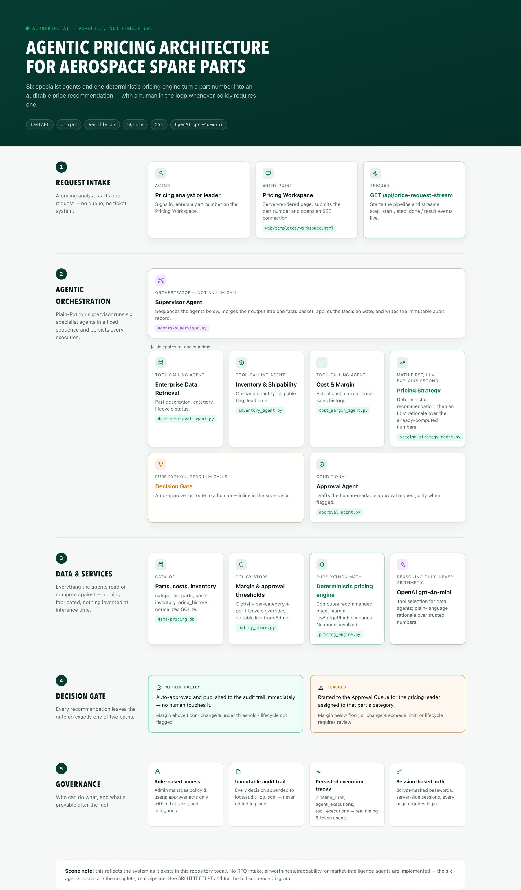
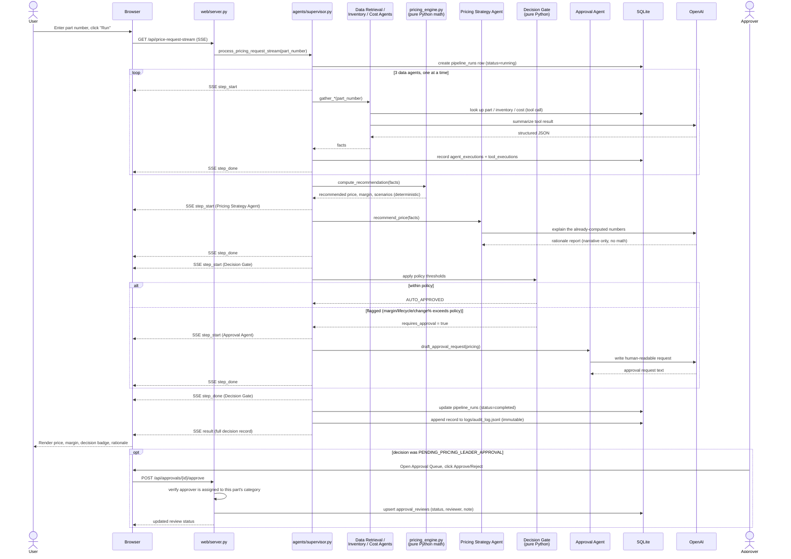
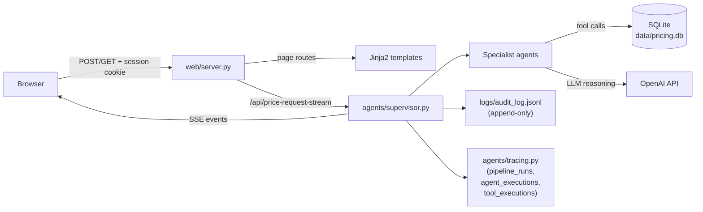
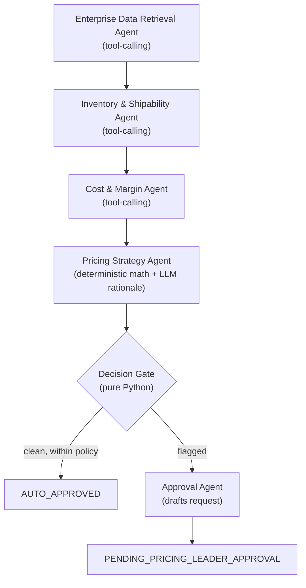

# AeroPrice AI — Current Architecture

This document describes the system as it actually exists in this repository today
— not a design aspiration. It reflects the real agent pipeline, data model, auth
model, and request lifecycle currently implemented in `agents/` and `web/`.

*(Source: [`docs/architecture.html`](docs/architecture.html) — a standalone page,
open it directly in a browser for the live version.)*

## Tech stack

| Layer | Technology |
|---|---|
| Backend | Python, FastAPI |
| Templates | Jinja2 (server-rendered, no frontend framework) |
| Frontend | Vanilla HTML / CSS / JavaScript |
| Real-time updates | Server-Sent Events (SSE) |
| Database | SQLite (`data/pricing.db`) |
| AI model | OpenAI `gpt-4o-mini`, manual tool-calling loop |
| Auth | Server-side sessions (bcrypt-hashed passwords, cookie-based) |

## End-to-end flow: how a pricing request actually works

This traces one real request start to finish — a user submitting a part number
on the Pricing Workspace, through every agent, to either an auto-approved
decision or a human review.

## High-level request flow

## The agent pipeline

`agents/supervisor.py` is the orchestrator — plain Python, not an LLM call. It runs
each specialist agent in a fixed sequence, merges their output into one facts
packet, and applies the Decision Gate:

**Core design rule:** the LLM never does arithmetic or has final authority on a
pricing or approval decision. The three data agents call tools (read-only
lookups against the SQLite catalog) and the LLM only reasons about which tool to
call and how to summarize the result. The actual price math lives entirely in
`agents/pricing_engine.py` (pure Python); the LLM is handed the already-computed
numbers and asked only to explain them in `agents/pricing_strategy_agent.py`. The
Decision Gate is 100% deterministic Python — no model call.

### Agents and their system boundary

| Agent | File | Owns |
|---|---|---|
| Enterprise Data Retrieval | `agents/data_retrieval_agent.py` | Parts master (description, category, lifecycle) |
| Inventory & Shipability | `agents/inventory_agent.py` | On-hand qty, shipability, lead time |
| Cost & Margin | `agents/cost_margin_agent.py` | Cost data + price history |
| Pricing Strategy | `agents/pricing_strategy_agent.py` | Deterministic recommendation + LLM rationale report |
| Decision Gate | inline in `agents/supervisor.py` | Auto-approve vs. route to human (pure Python) |
| Approval Agent | `agents/approval_agent.py` | Drafts the human-readable approval request |

Policy thresholds (min/target/max margin, auto-approval change limits, and
per-category/per-lifecycle overrides) live in `agents/policy_store.py`, backed by
the `policy_global`, `category_policy_overrides`, and `lifecycle_policy_overrides`
tables — editable live from the Admin console, no redeploy needed.

## Real-time execution visibility

`GET /api/price-request-stream` streams Server-Sent Events as each agent starts
and finishes (`step_start` / `step_done` / `result`), driving the live pipeline
UI on the Pricing Workspace page and the Agent Activity network visualization on
Overview. Every agent execution is also **persisted** (not just streamed) via
`agents/tracing.py`:

- `pipeline_runs` — one row per end-to-end pricing request
- `agent_executions` — one row per specialist agent step, with timing, token
  usage, and estimated cost
- `tool_executions` — one row per tool call inside an agent step, with
  sanitized arguments/results

This is what powers the Agent Activity page's execution traces and the
dashboard's real "agent execution success rate" metric — nothing there is
simulated.

## Auth and authorization

Every page in the app requires a logged-in session (server-side session table,
bcrypt-hashed passwords, httponly cookie). Two roles:

- **admin** — manages users, assigns approvers to categories, edits pricing
  policy, can act on any pending approval.
- **approver** — a category-scoped pricing leader. Sees and can only act on
  pending approvals in the categories an admin assigned them; Decision History
  and Agent Activity are hidden from this role since those views span
  categories beyond their assigned scope.

Category-to-approver assignment is many-to-many (`category_approvers` table),
so a category can have more than one eligible approver.

## Data model (SQLite, `data/pricing.db`)

**Catalog** (built by `scripts/build_database.py` from `scripts/schema.sql`,
destructively rebuilt on each run): `categories`, `aircraft_programs`,
`manufacturers`, `lifecycle_statuses`, `warehouses`, `parts`, `costs`,
`inventory`, `price_history`, `policy_global`, `category_policy_overrides`,
`lifecycle_policy_overrides`.

**App state** (created lazily via `CREATE TABLE IF NOT EXISTS`, independent of
the catalog rebuild, so they survive it): `users`, `sessions`,
`category_approvers`, `approval_reviews`, `pipeline_runs`, `agent_executions`,
`tool_executions`.

**Audit trail**: `logs/audit_log.jsonl` — append-only JSON Lines, one record per
completed pricing decision. Deliberately separate from the mutable
`approval_reviews` table: the audit log is immutable history of what the AI
decided; the review table is mutable state for whether a human has since
approved or rejected it.

## Pages

| Route | Page | Access |
|---|---|---|
| `/` | Overview — hero, KPIs, agent network viz, decision mix, performance | Logged in |
| `/workspace` | Pricing Workspace — submit requests, live SSE pipeline, decision report | Logged in |
| `/approvals` | Approval Queue | Logged in |
| `/history` | Decision History | Logged in, not approver |
| `/agent-activity` | Agent Activity — persisted execution traces | Logged in, not approver |
| `/admin/*` | Global Policy / Category Overrides / Lifecycle Overrides / Users | Admin only |
| `/login` | Sign in (or first-run "create admin" setup if zero users exist) | Public |

## What's deliberately out of scope

- No React/Vue/Next.js — server-rendered Jinja2 + vanilla JS throughout, by
  explicit design constraint carried through every redesign round.
- No RFQ intake, airworthiness/traceability, or market-intelligence agents —
  these were scoped in an earlier planning pass but never implemented; the
  pipeline above is the complete, real agent set.
- No horizontal scaling / connection pooling — one SQLite connection per
  call, appropriate for the local/demo scale this runs at.
